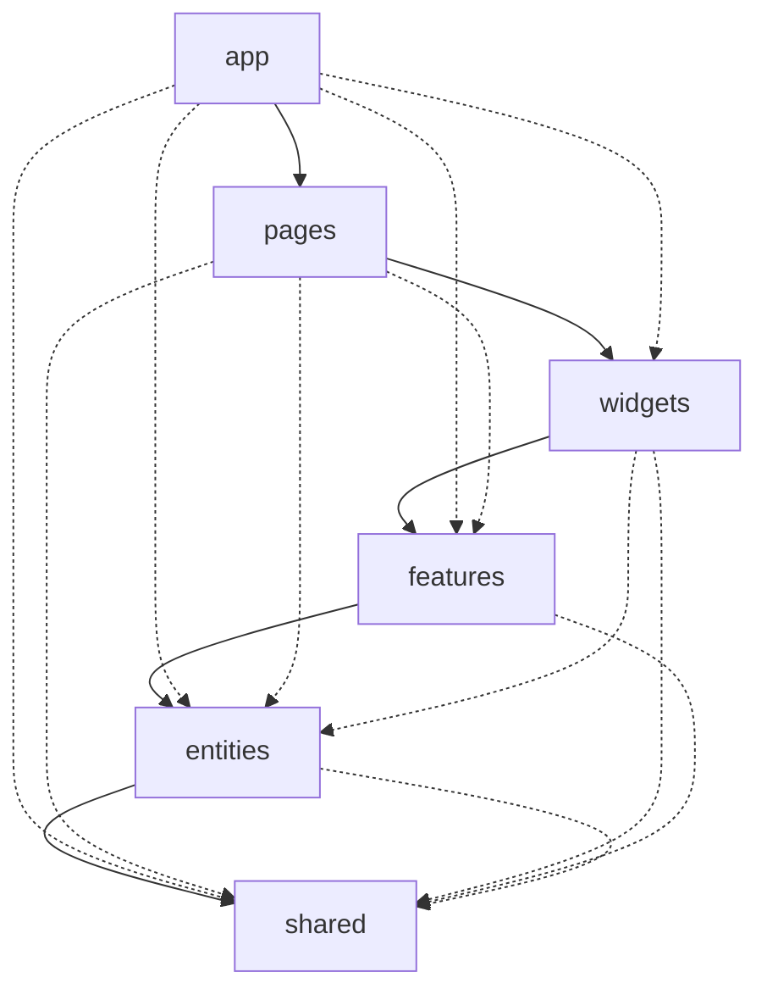

# vue-lottery-app

Лабораторна робота №6: архітектура Feature-Sliced Design, керування станом (Pinia), UI-бібліотека PrimeVue.
Попередня робота (№5): маршрутизація (Vue Router), патерн Repository для DummyJSON, авторизація через JWT.
Стек: Vue 3 (Composition API, TypeScript), Vue Router, Pinia, VeeValidate + Zod, PrimeVue, Bootstrap 5 (SCSS), ESLint + Steiger.

## Запуск

```sh
cp .env.example .env   # один раз: адреса API (на Windows: copy .env.example .env)
npm install
npm run dev            # http://localhost:5173
npm run lint           # oxlint + eslint + steiger
npm run lint:fsd       # лише перевірка правил FSD (Steiger)
npm run build
npm run deploy         # збірка і публікація на GitHub Pages (гілка gh-pages)
```

Тестовий акаунт DummyJSON: `emilys` / `emilyspass`.

## Архітектура (Feature-Sliced Design)

Шар може імпортувати лише з шарів, що розташовані нижче. Слайси одного шару не імпортують один одного.
Звернення до слайса виконується лише через його `index.ts` (Public API). Правила перевіряє `npm run lint:fsd`.



```
src/
  app/                 main.ts, App.vue, layouts, styles
    providers/         router (маршрути, guard-и), services.ts (реєстрація сервісів), ui.ts (PrimeVue), pinia.ts
  pages/               home, about, users, user-details, user-create, user-edit, login, not-found
  widgets/             app-header (AppHeader, AppNavigation, AppLogo), users-table, winners-list
  features/            auth (LoginForm, LogoutButton), user-form, delete-user, theme-toggle
  entities/            user (типи, UserService, useUsersStore), session (AuthService, useSessionStore)
  shared/              api (http-client, інтерфейси Repository, ServiceProvider), ui (обгортки над PrimeVue), lib, config
```

### Repository у структурі FSD

| Частина | Розташування |
| --- | --- |
| HTTP-клієнт, інтерфейси Readable, Creatable, Editable, Deletable | `shared/api` |
| User, CreateUserDto, UpdateUserDto | `entities/user/model` |
| UserService | `entities/user/api` |
| AuthService | `entities/session/api` |
| ServiceProvider (універсальний реєстр) | `shared/api` |
| Реєстрація UserService та AuthService | `app/providers/services.ts` |

### Pinia

- `useSessionStore` (`entities/session`): токени, користувач, `isAuthenticated`, `setSession` / `clearSession`.
  Синхронізація з localStorage виконана вручну.
- `useUsersStore` (`entities/user`): список, `total`, `isLoading`, `error`, `fetchUsers`, `fetchUser`, `createUser`, `updateUser`, `removeUser`.
- `useAuthStore` (`features/auth`): сценарії входу, виходу й оновлення токена поверх сесії.
- `useThemeStore` (`features/theme-toggle`): світла/темна тема, збереження через `pinia-plugin-persistedstate`.

**Ручне збереження і плагін.** У `session.store.ts` потрібно самому читати localStorage при старті, стежити за змінами
(`watch`) і обробляти помилки, зате можна зберігати лише потрібну форму даних і повністю контролювати момент запису.
У `theme.store.ts` те саме дає один рядок `persist: { key, pick }`: менше коду і однаковий підхід для всіх сторі,
але менше гнучкості (наприклад, складніше обробити недоступний localStorage чи змінити формат).

### UI-бібліотека

Використано PrimeVue (тема Aura з основним зеленим кольором застосунку). Компоненти імпортуються окремо
(`primevue/button`, `primevue/datatable` тощо), тому в бандл потрапляє лише використане.
Прямі імпорти `primevue/*` є лише в `shared/ui` та `app/providers/ui.ts`.
Обгортки: `AppButton`, `AppInput`, `AppSelect`, `AppTable`, `AppConfirmDialog`, `AppToast` (`useAppToast`).

## Налаштування середовища

Адреса API зберігається у `.env` (`VITE_API_URL`), приклад - `.env.example`.
